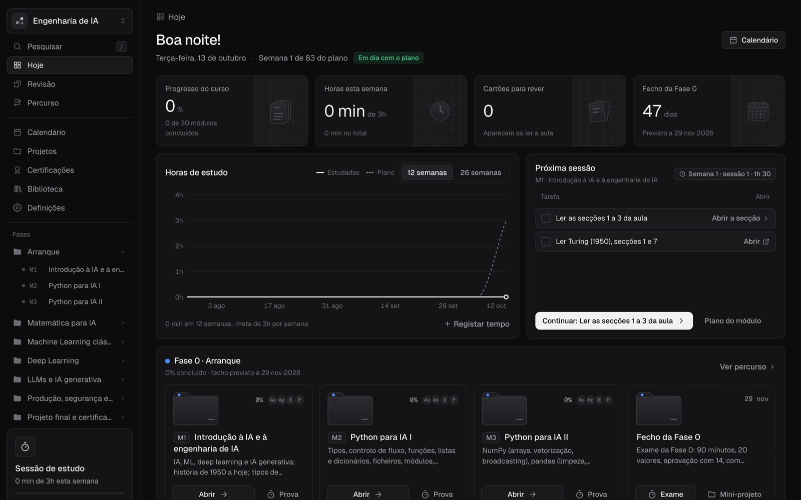
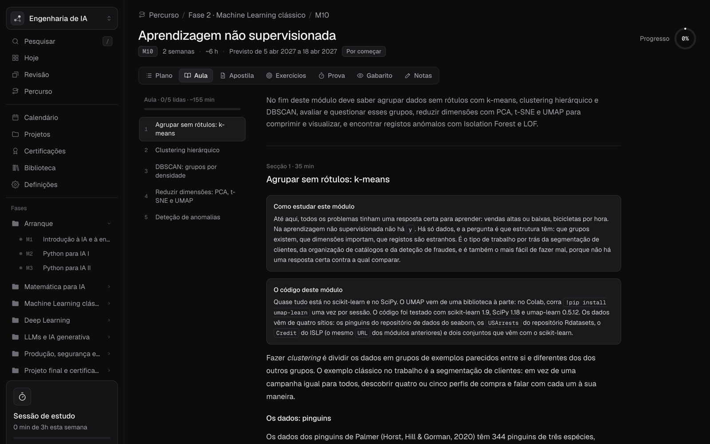
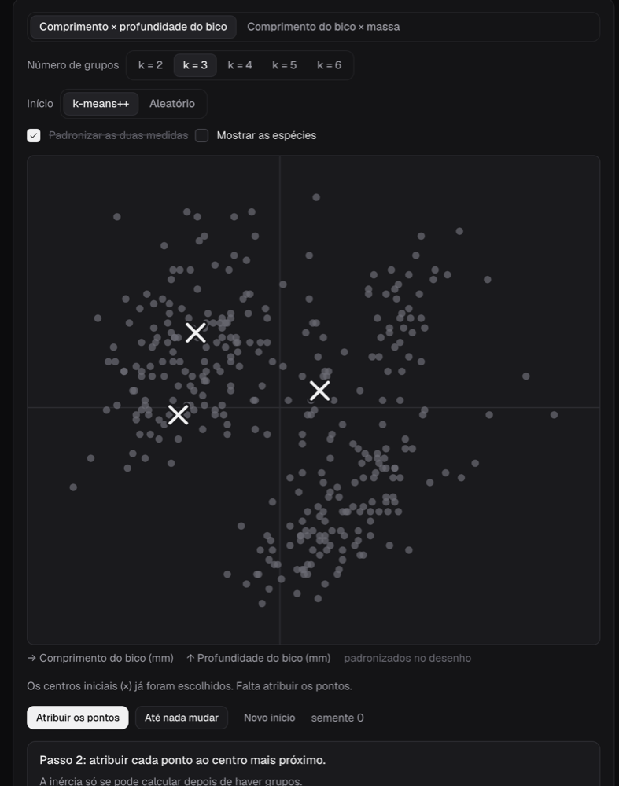
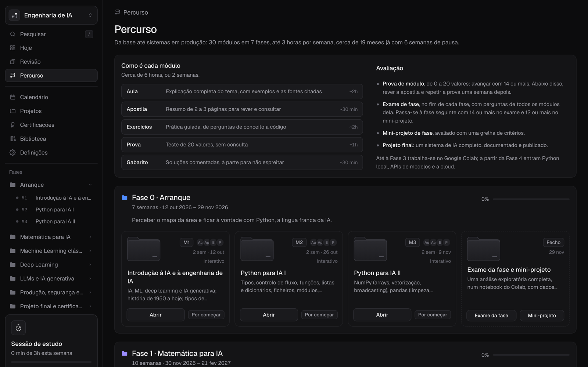

# AI Engineering — a self-study platform

**A platform I built to teach myself AI Engineering with the discipline of a proper course.**

30 modules across 7 phases, from October 2026 to May 2028: from an introduction to AI and Python all the way to deep learning, LLMs and production systems.

**[▶ Try the demo](https://guiboorges.github.io/plataforma-engenharia-ia/)** · your progress is saved in your browser

The interface and all course material are in Portuguese, since this is my own personal course.



## Why it exists

Self-study is easy to start and hard to sustain. Online courses give you videos and loose exercises, but no plan, no deadlines, no real exams and no way to tell whether you're actually learning.

This platform brings all of that together in one place:

- **A dated plan.** Every module has its weeks set on the calendar (with Christmas and summer breaks) and a target of 3 hours per week. The *Today* screen shows the next session and whether I'm on track.
- **Assessment you can't cheat on.** Each exercise's answer key only unlocks after you submit an attempt. Exams are timed and closed-book: nothing else is visible while an exam is running. The pass mark is 14 out of 20; below that, a retake only opens a week later.
- **Learning by doing.** Lesson diagrams become interactive widgets: run k-means step by step, play with PCA, watch a SHAP plot build itself.
- **Not forgetting.** Spaced-repetition flashcards appear as you read through each lesson.

## What's inside

| Area | What it does |
|---|---|
| **Today** | Next study session, hours this week, cards due for review, status against the plan |
| **Modules** | Plan, Lesson, Handbook, Exercises, Exam, Answer key and Notes |
| **Widgets** | Russell & Norvig grid, AI timeline, spam lab (Naive Bayes matching scikit-learn), slicing and aliasing in Python, broadcasting and group-by, linear transformations and SVD, k-means, DBSCAN, PCA, cross-validation, decision thresholds, SHAP |
| **Exercises** | Auto-graded where possible; written answers are graded against the answer key's criteria |
| **Exams** | Timer, closed-book, auto-graded multiple choice |
| **Path and Calendar** | The 7 phases, the 30 modules and the week-by-week plan |
| **Projects and Certifications** | Rubrics for the mini-projects, the capstone project and the certifications to take |
| **Tutor** | Explains the lesson and your mistakes using Claude, without giving away answers to unfinished exercises (only in the claude.ai Artifact version) |

<table>
  <tr>
    <td width="60%"></td>
    <td width="40%"></td>
  </tr>
  <tr>
    <td align="center"><sub>A lesson with sections, tested code and cited sources</sub></td>
    <td align="center"><sub>k-means widget: pick k and the starting points, then step through</sub></td>
  </tr>
</table>



## How it was built

- **Code:** React 18 + TypeScript + Vite, with no UI libraries. The visual system is documented in [`design/DESIGN.md`](design/DESIGN.md).
- **Content:** I created the course material (lessons, handbooks, exercises, exams and answer keys) with Claude. Code outputs are verified in Python with scikit-learn before they go into the lessons.
- **Where it runs:** as an Artifact on claude.ai (with the tutor and progress saved to your account) or as a static site (progress stored in `localStorage`).

## Running locally

```bash
npm install
npm run dev          # http://localhost:5173
npm run build:pages  # static site in dist/ (same as the demo)
```

In Settings you can change the start date and the weekly target, and export or import a backup of your progress.

## Structure

```
src/
  content/      course plan, interactive modules (m1.ts … m11.ts) and phase wrap-ups
  components/   screens, exercises, exams and each module's widgets
  lib/          progress, calendar, exams, spaced repetition, Naive Bayes, tutor
  styles/       tokens (dark and light themes) and per-area styles
scripts/        course material sync and builds (Artifact and GitHub Pages)
```
